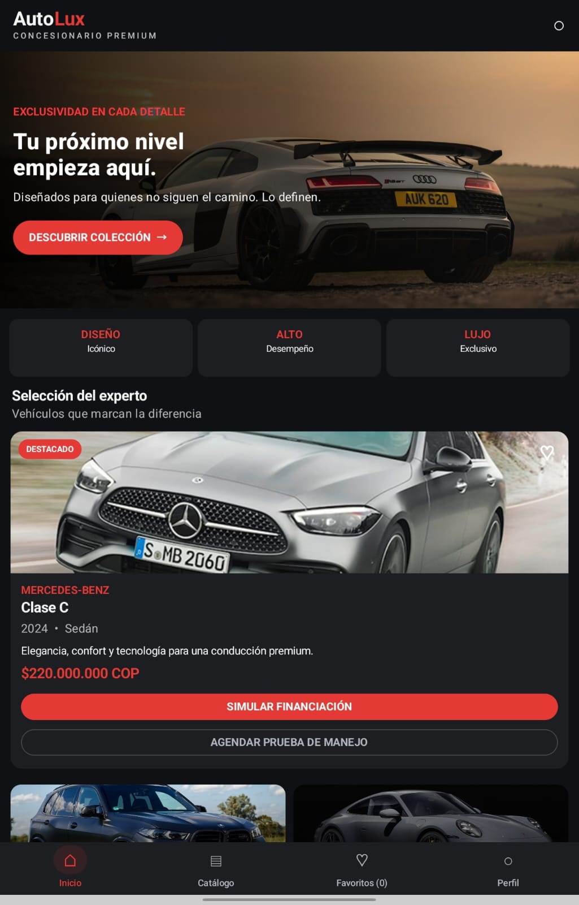
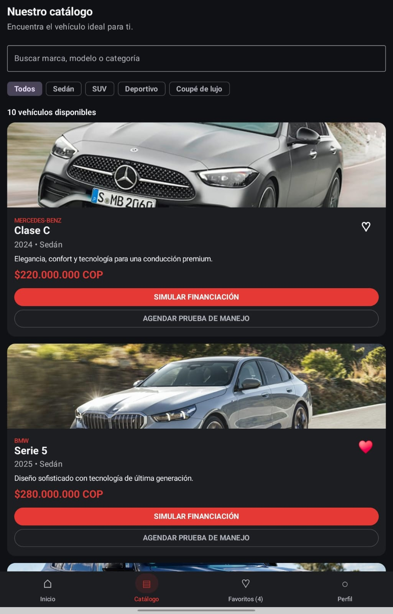
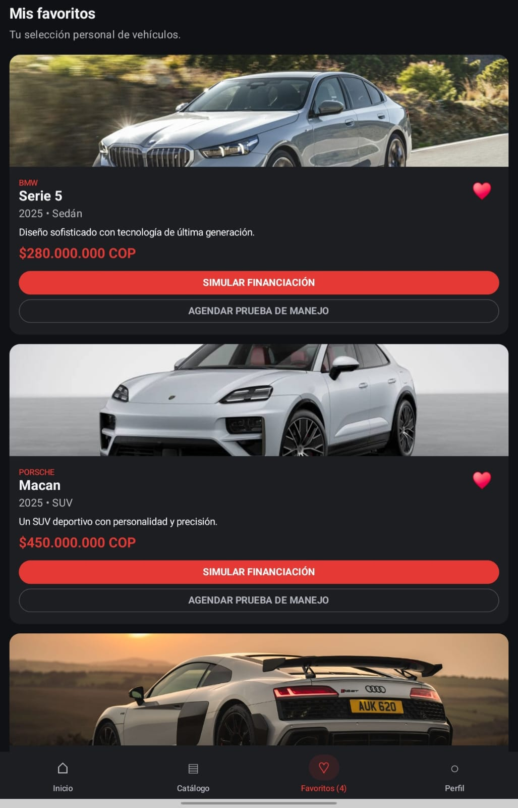
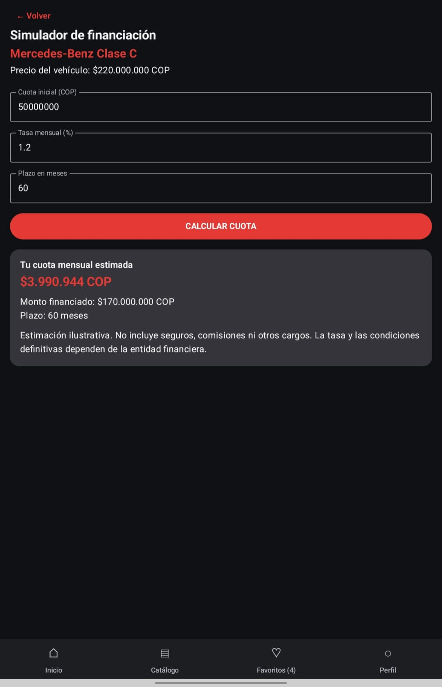
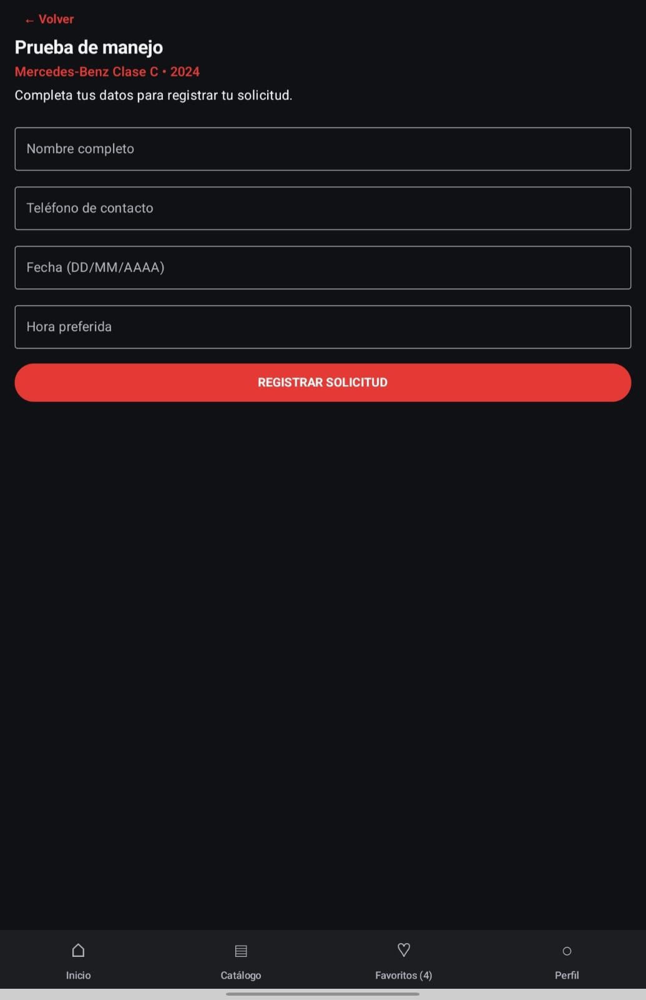

# AutoLux — Concesionario Premium

## 1. Descripción del negocio

AutoLux es una aplicación móvil para un concesionario de vehículos premium. Permite explorar un catálogo de automóviles de diferentes marcas, consultar sus características y precios, guardar favoritos y acceder a herramientas relacionadas con la compra de un vehículo.

## 2. Objetivo de la aplicación

Desarrollar una aplicación móvil con Kotlin y Jetpack Compose que facilite la exploración de vehículos y ofrezca una experiencia visual elegante, intuitiva e interactiva.

## 3. Pantallas implementadas

- **Inicio:** presenta la identidad visual de AutoLux, vehículos destacados y accesos a categorías como SUV y deportivos.
- **Catálogo:** permite consultar los vehículos, buscar por marca, modelo o categoría y filtrar por tipo de vehículo.
- **Favoritos:** muestra los vehículos guardados por el usuario.
- **Perfil:** ofrece accesos a las opciones de prueba de manejo y financiación.
- **Prueba de manejo:** permite ingresar datos de contacto y preferencias para registrar una solicitud.
- **Financiación:** permite calcular una cuota mensual estimada para un vehículo.

La navegación entre las pantallas se implementa mediante Navigation Compose.

## 4. Funcionalidades interactivas

### 4.1. Búsqueda de vehículos — Funcionalidad trabajada en clase

El usuario puede buscar vehículos por marca, modelo o categoría. También puede utilizar los filtros para consultar vehículos de un tipo específico, como SUV, deportivo o coupé.

### 4.2. Gestión de favoritos — Funcionalidad nueva 1

El usuario puede marcar y desmarcar vehículos como favoritos y consultar su selección en una pantalla independiente.

### 4.3. Simulador de financiación — Funcionalidad nueva 2

La aplicación permite introducir valores para calcular una cuota mensual estimada y ayudar al usuario a explorar una posible financiación.

### Funcionalidad adicional

La aplicación incluye un formulario para registrar una solicitud de prueba de manejo, con información de contacto y preferencias de fecha y hora.

## 5. Capturas de pantalla

Agregar aquí capturas de las siguientes pantallas:

## 5. Capturas de pantalla

### Inicio

### Catálogo

### Favoritos

### Simulador de financiación

### Prueba de manejo

## 6. Requisitos para ejecutar el proyecto

- Android Studio.
- JDK compatible con la versión de Android Gradle Plugin del proyecto.
- SDK de Android configurado según los archivos Gradle del proyecto.

## 7. Instrucciones de ejecución

1. Descargar este repositorio.
2. Abrir el proyecto desde Android Studio.
3. Esperar a que finalice la sincronización de Gradle.
4. Seleccionar un emulador o conectar un dispositivo Android.
5. Ejecutar la aplicación mediante el botón **Run**.

---
